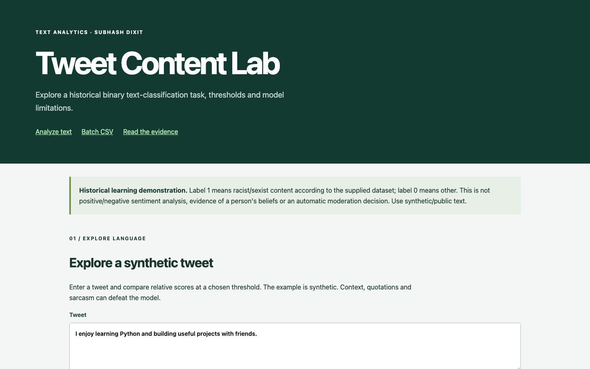
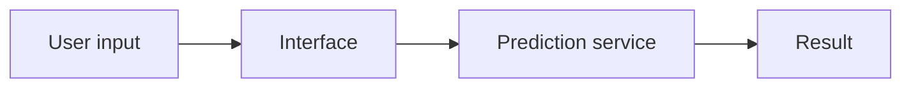
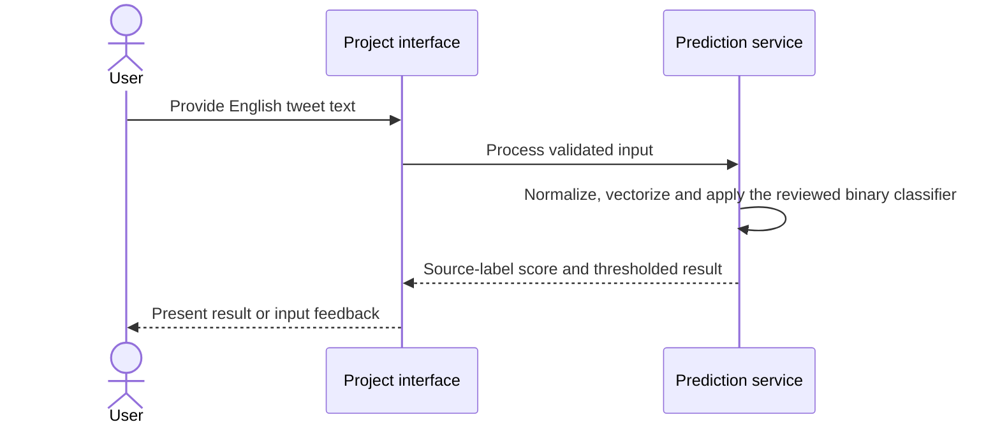
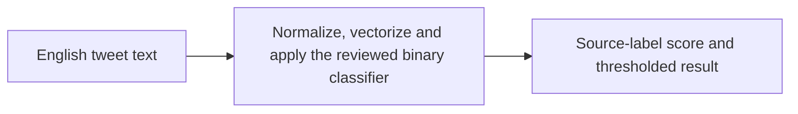
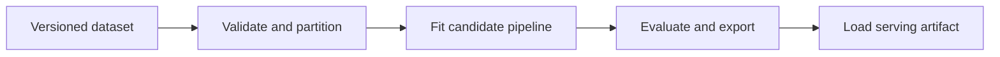
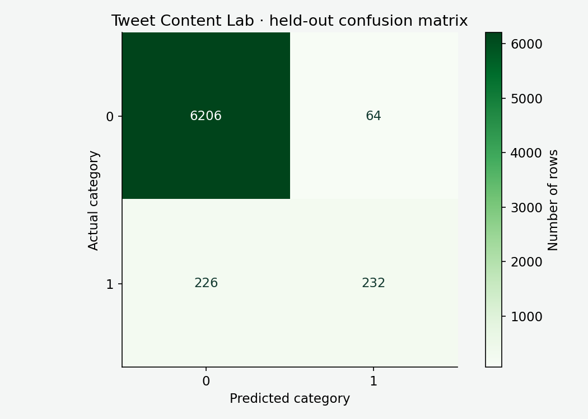

# Tweet Content Classifier

## 1. Project overview

Flask app for historical racist/sexist tweet source-label classification with a documented manual Render release.

[Live demo](https://tweet-content-classifier.onrender.com) · [Source repository](https://github.com/subhashdixit/tweet-content-classifier)



## 2. Motivation and problem statement

### Objective

Evaluate a text classifier against the supplied historical racist/sexist binary labels.

### Problem statement

Positive examples are uncommon and the source labels do not cover every kind of harmful language.

### Motivation

Held-out class metrics show where a threshold changes misses and false alarms.

## 3. Solution and scope

**Inputs** — English tweet text. **Outputs** — Source-label score and thresholded result.

## 4. Quick start and usage

Start with the documented sample or supported input. Review the output and any validation feedback. Open the live demo above or use the local setup below.

## 5. High-level architecture



## 6. End-to-end request workflow



## 7. Data sources, inputs, and outputs

| Input | Processing | Output |
| --- | --- | --- |
| English tweet text | Normalize, vectorize and apply the reviewed binary classifier | Source-label score and thresholded result |

### Problem and data

The training CSV contains **31,962 labelled tweets**: 29,720 class 0 and 2,242 class 1. Class 0 means the source did not assign its racist/sexist label; it does not guarantee harmless content. The separate **17,197-row test CSV has no labels**, so it cannot establish accuracy. Dataset annotation instructions, consent, authorship and current representativeness have not been independently verified.

Repeated normalized text is grouped before splitting to reduce duplicate leakage. The split is approximately 60/20/20, with 19,005 training, 6,229 validation and 6,728 held-out test rows. It is not author-separated or chronological. Related paraphrases and author effects can still cross splits.

```mermaid
flowchart LR
 A[Historical labelled tweets] --> B[Normalize and group duplicates]
 B --> C[Train / validation / test groups]
 C --> D[Training-only TF-IDF vocabulary]
 D --> E[Dummy / Naive Bayes / Logistic Regression]
 E --> F[Validation average precision and threshold]
 F --> G[One held-out test evaluation]
 G --> H[Trusted saved pipeline]
 H --> I[Flask form / JSON / CSV]
```



## 8. Data flow and ETL pipeline





## 9. Low-level design and interfaces

Implementation entry points are [`wsgi.py`](<wsgi.py>), [`scripts/train.py`](<scripts/train.py>), [`src/tweet_classifier/service.py`](<src/tweet_classifier/service.py>), [`src/tweet_classifier/web.py`](<src/tweet_classifier/web.py>).

## 10. Concepts and algorithms

### How the model works

1. **Normalization** standardizes text for duplicate grouping and representation. This reduces superficial differences; it does not understand sarcasm or intent.
2. **TF-IDF** turns words and adjacent word pairs into sparse numeric features. A term becomes influential when it appears in a document but is less common across the corpus. The vocabulary is limited to 20,000 features and learned from training text only.
3. **Multinomial Naive Bayes** estimates class evidence from feature counts/weights, assuming features are conditionally independent. It is fast and compact; correlated phrases and context violate that simplifying assumption.
4. **Logistic regression** provides a linear discriminative comparison. A majority dummy establishes the performance of ignoring the input entirely.
5. Models are compared on validation **average precision**. The chosen model is Naive Bayes. A validation F1 search selects a positive-label threshold of approximately **0.15**. A 0.5 default is not automatically appropriate for imbalanced data.
6. The frozen pipeline is evaluated on test data once. Runtime never retrains from user submissions.

The score is not a calibrated probability that a statement is harmful. Moving the threshold changes the balance between false alarms and missed positive labels. A low threshold usually finds more positives and also raises more false alarms. Vocabulary warnings expose inputs for which the learned words provide little evidence.

## 11. Technology choices and dependencies

- **Python**. Keep dataset preparation, fitting, and evaluation reproducible outside the serving path.
- **Flask**. Share the same service across interactive and HTTP entry points.

[Dependency versions and runtime rationale](DEPENDENCIES.md)

## 12. Training, inference, and evaluation

### Measured results

| Held-out measure | Value | Meaning and limitation |
|---|---:|---|
| Accuracy | 0.9569 | Most examples are class 0; accuracy alone can hide misses. |
| Macro F1 | 0.7963 | Gives both classes equal weight; depends on the chosen threshold. |
| Positive precision | 0.7838 | Of predicted class 1 examples, the share labelled 1 in this source. |
| Positive recall | 0.5066 | Finds only about half of the source positives; missed positives matter. |
| Positive F1 | 0.6154 | Harmonic balance of precision and recall; not a measure of fairness. |
| Average precision | 0.7014 | Ranks positive examples across thresholds; depends on prevalence. |
| ROC AUC | 0.9335 | Ranking across positive/negative pairs; can look optimistic under imbalance. |

Confusion matrix, rows actual and columns predicted: `[[6206, 64], [226, 232]]`. The full candidate results, split counts, source hash, threshold and dependency versions are in [models/metrics.json](models/metrics.json).



### Reproduce training and validate

```bash
python scripts/train.py
python scripts/plot_results.py
python -m black --check src scripts tests wsgi.py gunicorn.conf.py
python -m pylint src scripts wsgi.py gunicorn.conf.py
python -m pytest -q
python scripts/smoke_test.py --url http://127.0.0.1:8000 --attempts 3
```

Training reads the original labelled CSV, reconstructs the grouped split, fits candidate pipelines and writes `models/pipeline.joblib`, `models/metrics.json`, `models/sample.json`. Plotting creates the result image. Training can take several minutes. Regenerating artifacts is a model change: review results and update the artifact hash together. Python pickle/joblib can execute code; load only trusted repository artifacts, never an uploaded model. The serving service checks the recorded SHA-256 before loading. A hash detects accidental mismatch, not a malicious change to both files.

Tests exercise real-model predictions, threshold handling, input limits, unknown vocabulary, CSV and HTTP routes. Black keeps formatting consistent; Pylint checks common mistakes; pytest checks behavior. Passing these does not prove unbiased or production-safe moderation.

Validation code is available in [`tests/test_application.py`](<tests/test_application.py>).

## 13. Limitations and data handling

### Responsible interpretation and next steps

Dialect, identity terms, sarcasm, quotation and changes in language can cause serious errors. A random grouped text split is not a current population audit. Useful next work includes independently reviewed labels, author/time-separated testing, subgroup error analysis, probability calibration and a human review workflow. Those are not claimed as completed. There is no live social-platform integration, user profiling or automated enforcement.

References: [scikit-learn leakage guidance](https://scikit-learn.org/stable/common_pitfalls.html), [model evaluation](https://scikit-learn.org/stable/modules/model_evaluation.html), [Render Flask guide](https://render.com/docs/deploy-flask).

## 14. Installation and local setup

### Run locally

Use Python 3.10 or 3.11. Commands assume a POSIX shell; on Windows activate `.venv\Scripts\activate` instead.

```bash
git clone https://github.com/subhashdixit/tweet-content-classifier.git
cd tweet-content-classifier
python3 -m venv .venv
source .venv/bin/activate
python -m pip install -r requirements-dev.txt
python -m pip install --no-deps -e .
python -m flask --app wsgi:app run --port 8000
```

Open `http://127.0.0.1:8000`. The bundled model allows immediate inference. Enter text and select **Classify**. Download the example CSV to see the required `tweet` column. Uploads are bounded to 1 MiB and at most 200 records. Invalid, empty or excessive input is rejected. Uploaded content is processed in memory and is not saved by application code; hosting infrastructure can still retain normal connection/request metadata.

```bash
curl -s http://127.0.0.1:8000/health/ready
curl -s http://127.0.0.1:8000/api/metrics
curl -s -X POST http://127.0.0.1:8000/api/predict \
  -H 'Content-Type: application/json' \
  -d '{"records":[{"tweet":"I enjoyed the community event today"}],"threshold":0.15}'
curl -s -X POST http://127.0.0.1:8000/predict-csv \
  -F file=@example.csv -o predictions.csv
```

Scores, the applied threshold and the source class label are returned. The CSV contains row identifiers and predictions rather than echoing submitted text. These endpoints are public demo endpoints, not authenticated enterprise APIs.

### Exact local dependency versions

[DEPENDENCIES.md](DEPENDENCIES.md) lists the pinned runtime, development and training environments. `requirements.txt` now explicitly records all external runtime package versions, including transitive dependencies.

```bash
python3.11 -m venv .venv
# Activate: source .venv/bin/activate (Windows: .venv\Scripts\activate)
python -m pip install -r requirements.txt
python -m pip check
```

## 15. Repository structure

### Project layout

```text
src/tweet_classifier/  service and Flask application factory
  templates/          server-rendered interface
  static/             local CSS, no external UI framework
scripts/              training, plotting and real HTTP smoke checks
models/               frozen pipeline, evaluation and sample
tests/                behavior checks
render.yaml           manual free-plan release configuration
Dockerfile            optional reproducible Linux runtime
archive/              preserved original documentation
```

## 16. Deployment and operations

### Manual Render deployment

This project deliberately demonstrates a **manual release**, without a custom GitHub Actions workflow. Run the quality checks before every release. The hosting configuration sets `autoDeployTrigger: off`, so a GitHub push does not automatically publish a new version.

1. Connect this repository to Render and create a Blueprint using `render.yaml`.
2. Confirm **Free**, branch `main`, the production dependency/package build command and Gunicorn start command. No API keys or paid database are required.
3. Deploy the Blueprint. Render builds the Python environment and starts the web process. `/health/ready` reports its actual `RENDER_GIT_COMMIT`.
4. Open the assigned `onrender.com` URL, classify sample text and download/score the example CSV. Run `python scripts/smoke_test.py --url YOUR_URL --expected-revision COMMIT` from your local environment.
5. Inspect service logs for missing files, dependency incompatibility or incorrect commands. Never enable Flask debug mode on the public service.

For each update, run Black, Pylint and pytest locally, merge the reviewed change, then use **Manual Deploy → Deploy latest commit** in Render. Verify the reported commit and smoke test again. CI would automate the quality gate; this example deliberately makes the maintainer responsible for executing it. Manual deployment still has a release process, but has no automatic trigger from a passing check.

To roll back, select an earlier successful deploy in Render, or revert the source/model change through a PR and manually deploy the resulting commit. Restore matching model files and dependencies together. Git versions code and artifacts; it does not automatically undo provider settings. Manual releases are easy to inspect but easier to forget or publish out of sequence than automated releases.

**Hosting** provides the machine and public HTTPS address. **Deployment** installs and starts a particular revision there. [Render free service limits](https://render.com/docs/free) include idle spin-down, shared monthly runtime and ephemeral disk. This demo is not an always-on guarantee. Serving uploads remain in memory; provider infrastructure may retain ordinary connection metadata. A live URL is added only after actual deployment verification.

### Optional Docker runtime

```bash
docker build -t tweet-content-classifier:local .
docker run --rm --read-only --tmpfs /tmp -p 8000:8000 tweet-content-classifier:local
```

Docker packages Python, dependencies, model and Gunicorn into a consistent runtime. It reduces “works on my machine” differences, but adds an image build and maintenance overhead. It does not create hosting or make the model accurate. The native Render deployment does not require Docker.

## 17. License, credits, and support

The repository does not contain a root LICENSE file. Check upstream and data-source terms before reuse. Report reproducible issues through [GitHub Issues](https://github.com/subhashdixit/tweet-content-classifier/issues).
