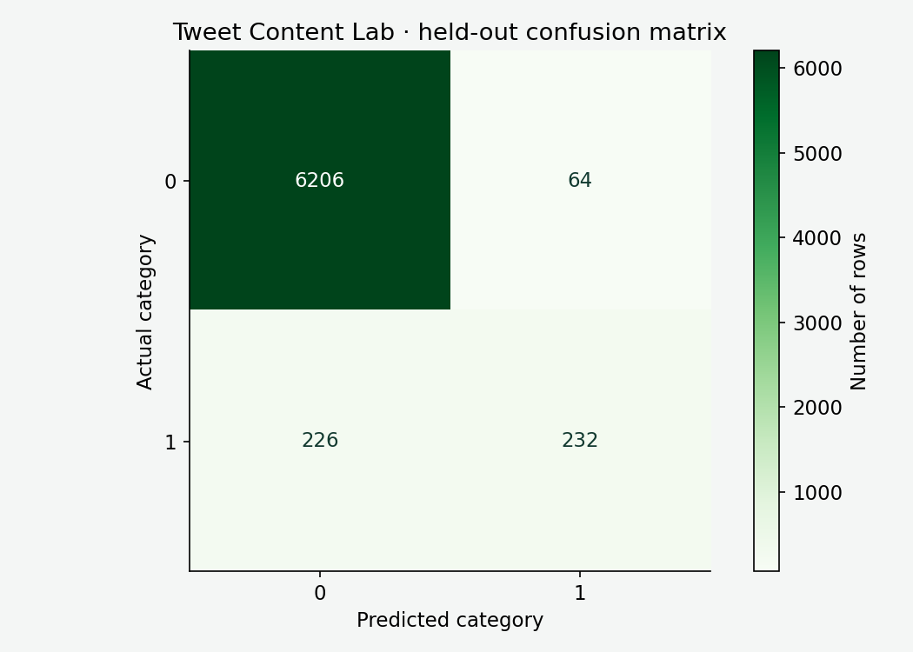

# Tweet Content Classifier

A Flask learning app that classifies English tweet text against the **historical racist/sexist binary labels in this repository**. This is not positive/negative sentiment analysis. The original repository was named `Twitter_Sentiment_Analysis`; its notebook and source CSVs remain available.

Enter text, inspect the model score and threshold, or score a small CSV. A prediction is a fallible pattern match against this source dataset, not a judgment about a person or a replacement for contextual human review.

## Problem and data

The training CSV contains **31,962 labelled tweets**: 29,720 class 0 and 2,242 class 1. Class 0 means the source did not assign its racist/sexist label; it does not guarantee harmless content. The separate **17,197-row test CSV has no labels**, so it cannot establish accuracy. Dataset annotation instructions, consent, authorship and current representativeness have not been independently verified.

Repeated normalized text is grouped before splitting to reduce duplicate leakage. The split is approximately 60/20/20, with 19,005 training, 6,229 validation and 6,728 held-out test rows. It is not author-separated or chronological. Related paraphrases and author effects can still cross splits.

```mermaid
flowchart LR
 A[Historical labelled tweets] --> B[Normalize and group duplicates]
 B --> C[Train / validation / test groups]
 C --> D[Training-only TF-IDF vocabulary]
 D --> E[Dummy / Naive Bayes / Logistic Regression]
 E --> F[Validation average precision and threshold]
 F --> G[One held-out test evaluation]
 G --> H[Trusted saved pipeline]
 H --> I[Flask form / JSON / CSV]
```



## How the model works

1. **Normalization** standardizes text for duplicate grouping and representation. This reduces superficial differences; it does not understand sarcasm or intent.
2. **TF-IDF** turns words and adjacent word pairs into sparse numeric features. A term becomes influential when it appears in a document but is less common across the corpus. The vocabulary is limited to 20,000 features and learned from training text only.
3. **Multinomial Naive Bayes** estimates class evidence from feature counts/weights, assuming features are conditionally independent. It is fast and compact; correlated phrases and context violate that simplifying assumption.
4. **Logistic regression** provides a linear discriminative comparison. A majority dummy establishes the performance of ignoring the input entirely.
5. Models are compared on validation **average precision**. The chosen model is Naive Bayes. A validation F1 search selects a positive-label threshold of approximately **0.15**. A 0.5 default is not automatically appropriate for imbalanced data.
6. The frozen pipeline is evaluated on test data once. Runtime never retrains from user submissions.

The score is not a calibrated probability that a statement is harmful. Moving the threshold changes the balance between false alarms and missed positive labels. A low threshold usually finds more positives and also raises more false alarms. Vocabulary warnings expose inputs for which the learned words provide little evidence.

## Measured results

| Held-out measure | Value | Meaning and limitation |
|---|---:|---|
| Accuracy | 0.9569 | Most examples are class 0; accuracy alone can hide misses. |
| Macro F1 | 0.7963 | Gives both classes equal weight; depends on the chosen threshold. |
| Positive precision | 0.7838 | Of predicted class 1 examples, the share labelled 1 in this source. |
| Positive recall | 0.5066 | Finds only about half of the source positives; missed positives matter. |
| Positive F1 | 0.6154 | Harmonic balance of precision and recall; not a measure of fairness. |
| Average precision | 0.7014 | Ranks positive examples across thresholds; depends on prevalence. |
| ROC AUC | 0.9335 | Ranking across positive/negative pairs; can look optimistic under imbalance. |

Confusion matrix, rows actual and columns predicted: `[[6206, 64], [226, 232]]`. The full candidate results, split counts, source hash, threshold and dependency versions are in [models/metrics.json](models/metrics.json).



## Run locally

Use Python 3.10 or 3.11. Commands assume a POSIX shell; on Windows activate `.venv\Scripts\activate` instead.

```bash
git clone https://github.com/subhashdixit/tweet-content-classifier.git
cd tweet-content-classifier
python3 -m venv .venv
source .venv/bin/activate
python -m pip install -r requirements-dev.txt
python -m pip install --no-deps -e .
python -m flask --app wsgi:app run --port 8000
```

Open `http://127.0.0.1:8000`. The bundled model allows immediate inference. Enter text and select **Classify**. Download the example CSV to see the required `tweet` column. Uploads are bounded to 1 MiB and at most 200 records. Invalid, empty or excessive input is rejected. Uploaded content is processed in memory and is not saved by application code; hosting infrastructure can still retain normal connection/request metadata.

```bash
curl -s http://127.0.0.1:8000/health/ready
curl -s http://127.0.0.1:8000/api/metrics
curl -s -X POST http://127.0.0.1:8000/api/predict \
  -H 'Content-Type: application/json' \
  -d '{"records":[{"tweet":"I enjoyed the community event today"}],"threshold":0.15}'
curl -s -X POST http://127.0.0.1:8000/predict-csv \
  -F file=@example.csv -o predictions.csv
```

Scores, the applied threshold and the source class label are returned. The CSV contains row identifiers and predictions rather than echoing submitted text. These endpoints are public demo endpoints, not authenticated enterprise APIs.

## Reproduce training and validate

```bash
python scripts/train.py
python scripts/plot_results.py
python -m black --check src scripts tests wsgi.py gunicorn.conf.py deploy
python -m pylint src scripts wsgi.py gunicorn.conf.py
python -m pytest -q
python scripts/smoke_test.py --url http://127.0.0.1:8000 --attempts 3
```

Training reads the original labelled CSV, reconstructs the grouped split, fits candidate pipelines and writes `models/pipeline.joblib`, `models/metrics.json`, `models/sample.json`. Plotting creates the result image. Training can take several minutes. Regenerating artifacts is a model change: review results and update the artifact hash together. Python pickle/joblib can execute code; load only trusted repository artifacts, never an uploaded model. The serving service checks the recorded SHA-256 before loading. A hash detects accidental mismatch, not a malicious change to both files.

Tests exercise real-model predictions, threshold handling, input limits, unknown vocabulary, CSV and HTTP routes. Black keeps formatting consistent; Pylint checks common mistakes; pytest checks behavior. Passing these does not prove unbiased or production-safe moderation.

## Project layout

```text
src/tweet_classifier/  service and Flask application factory
  templates/          server-rendered interface
  static/             local CSS, no external UI framework
scripts/              training, plotting and real HTTP smoke checks
models/               frozen pipeline, evaluation and sample
tests/                behavior checks
deploy/               PythonAnywhere WSGI example
Dockerfile            optional reproducible Linux runtime
archive/              preserved original documentation
```

## Manual PythonAnywhere deployment

This project deliberately demonstrates **manual release**, without a custom GitHub Actions workflow. Run the quality checks before every release. CI would automate those checks; this release path relies on the maintainer running them and recording the deployed revision.

1. Sign in to [PythonAnywhere](https://www.pythonanywhere.com/), open a Bash console and clone this repository under your account home directory.
2. Create a Python **3.11** virtual environment, activate it, install **production** dependencies with `pip install --no-cache-dir -r requirements.txt`, then `pip install --no-deps .`. Keep training and plotting dependencies off the small serving account.
3. In **Web → Add a new web app**, choose **Manual configuration**, matching Python 3.11. Set the virtualenv path to your environment and source/working directory to the checkout.
4. Replace the generated WSGI configuration using [deploy/pythonanywhere_wsgi.py](deploy/pythonanywhere_wsgi.py). Replace `YOUR_USERNAME` with your actual account name. Its absolute model path avoids working-directory mistakes.
5. In the checkout run `git rev-parse HEAD > RELEASE_REVISION`. This ignored file records the deployed Git revision. Click **Reload** on the Web tab.
6. Open the assigned `https://YOUR_USERNAME.pythonanywhere.com` address. Check `/health/ready`, submit sample text and upload the example CSV. Run `scripts/smoke_test.py --url YOUR_URL --expected-revision COMMIT` locally.
7. Inspect the Web error/server logs if startup fails. Common causes are a Python/virtualenv mismatch, an incorrect absolute checkout path or missing model files. Do not enable Flask debug mode publicly.

[Current free-account limits](https://help.pythonanywhere.com/pages/FreeAccountsFeatures/) include a small disk quota, a single web app/worker and renewal/expiry conditions. A deployed URL will be added after an authenticated deployment has actually been verified. Account setup is separate from having working source code.

For a new release, pull a reviewed commit, install changed requirements, write `RELEASE_REVISION`, reload and repeat the smoke check. To roll back, check out the previous known-good commit **with its matching model and dependencies**, rewrite the revision file and reload. Git records source/model history; it does not automatically undo provider settings. Manual release is easy to understand but is easier to forget and harder to scale than an automated, tested release gate.

## Optional Docker runtime

```bash
docker build -t tweet-content-classifier:local .
docker run --rm --read-only --tmpfs /tmp -p 8000:8000 tweet-content-classifier:local
```

Docker packages Python, dependencies, model and Gunicorn into a consistent runtime. It reduces “works on my machine” differences, but adds an image build and maintenance overhead. It does not create hosting or make the model accurate. PythonAnywhere's manual WSGI path does not require Docker.

## Responsible interpretation and next steps

Dialect, identity terms, sarcasm, quotation and changes in language can cause serious errors. A random grouped text split is not a current population audit. Useful next work includes independently reviewed labels, author/time-separated testing, subgroup error analysis, probability calibration and a human review workflow. Those are not claimed as completed. There is no live social-platform integration, user profiling or automated enforcement.

References: [scikit-learn leakage guidance](https://scikit-learn.org/stable/common_pitfalls.html), [model evaluation](https://scikit-learn.org/stable/modules/model_evaluation.html), [PythonAnywhere Flask guide](https://help.pythonanywhere.com/pages/Flask/).
